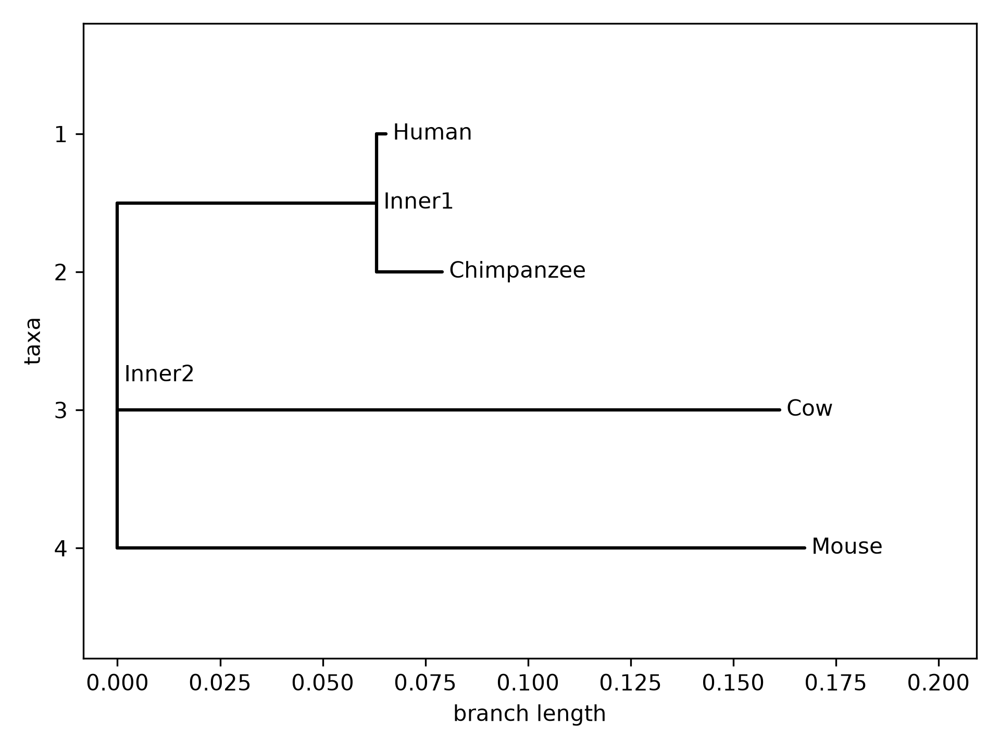

# Comparative Genomic Analysis of the Haemoglobin Beta(HBB) Gene across Vertebrate Species
## Project Overview
This project compares the Haemoglobin beta(HBB) mRNA gene across four selected vertebrate species to study sequence conservation and evolutionary relationship using Multiple Sequence Alignment and other Bioinformatics tools.
## Species Analyzed
- *Homo sapiens* (Human)
- *Pan troglodytes* (Chimpanzee)
- *Bos taurus* (Cow)
- *Mus musculus* (Mouse)
## Tools Used
- WSL2 (Ubuntu/Linux)
- Bash
- Clustal Omega
- Python
- Biopython
- Git & Github
- VS Code
## Repository Structure
- data/ - Input FASTA sequence from NCBI
- scripts/ - Python analysis scripts
- results/ - Alignment, Distance matrix, Phylogenetic tree
- report/ - Detailed project report
- README.md - Project overview
## Results 
- Number of Sequences = 4
- Alignment length = 657bp
- Conserved positions = 403
- Variable positions = 254
- Conservation = 61.34%
### Phylogenetic Tree

The phylogenetic analysis clustered Human and Chimpanzee together indicating high sequence similarity, while Cow and Mouseb formed more distant branch.
## How to Run
- python scripts/analysis.py 
- python scripts/phylogeny.py
## Future Improvement
- Include additional species.
- Perform bootstrap analysis for tree confidence.
- Calculate sequence identity percentages.
- Visualize conserved regions graphically.
- Extend the study to other globin genes.
### Author
Satakshi