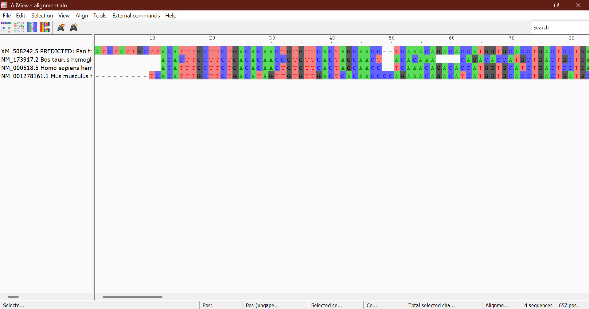
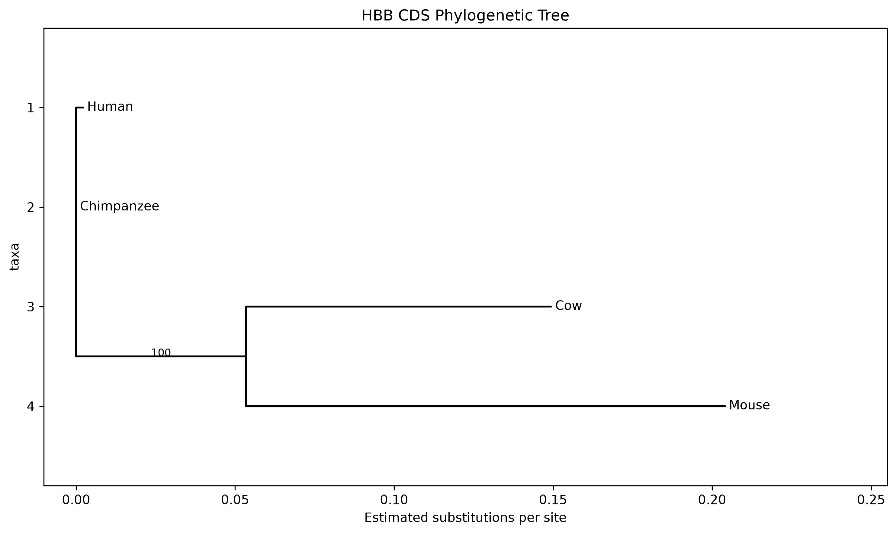

# Comparative Genomic Analysis of Haemoglobin Beta (HBB) mRNA Gene Across Selected Vertebrate Species
Author: Satakshi  
Course: BSc (Hons.) Bioinformatics

## 1. Introduction
- Haemoglobin:  
  Haemoglobin is a globular protein found in red blood cells of vertebrates. It contains iron, which enables it to transport oxygen from the respiratory organs to body tissues. This oxygen delivery supports aerobic respiration and metabolic activity. In mammals, haemoglobin is a tetramer made of two alpha and two beta globin chains, each containing a heme group with an iron atom that binds oxygen.

- HBB Gene:  
  The haemoglobin beta (HBB) gene encodes the beta-globin protein. In humans, this gene is located on chromosome 11. Mutations in HBB are associated with disorders such as sickle-cell disease and beta-thalassemia, which makes the gene highly significant in molecular biology and clinical genetics.

- Comparative Genomics:  
  Comparative genomics involves comparing genomic sequences across species to identify similarities, differences, and evolutionary relationships. This approach helps reveal conserved regions that are functionally important and variable regions that may reflect evolutionary divergence.

- Why HBB?  
  HBB is a suitable target for comparative analysis because it is functionally conserved across vertebrates, yet its nucleotide sequence still varies due to evolutionary changes. Studying HBB sequences across species can therefore help infer both conservation patterns and phylogenetic relationships.

In this study, The human (*NM_000518.5*), cow (*NM_173917.2*), and mouse (*NM_001278161.1*) sequences were retrieved from RefSeq mRNA records for HBB gene in NCBI. The chimpanzee sequence (*XM_508242.5*) is a predicted RefSeq transcript. These accession records were used to obtain the sequences for comparative analysis.
. Multiple sequence alignment was performed using Clustal Omega, followed by conservation analysis and phylogenetic tree construction using Python and Biopython. The results were used to investigate sequence conservation and evolutionary relationships among the selected vertebrate species.

## 2. Objectives
- To retrieve HBB mRNA sequences of the selected vertebrate species from the NCBI database.
- To perform multiple sequence alignment (MSA) using Clustal Omega.
- To identify conserved and variable nucleotide positions in the aligned sequences.
- To calculate conservation percentage and analyze gap distribution across sequences.
- To determine the evolutionary relationship among the selected species using phylogenetic analysis.
- To demonstrate the application of bioinformatics tools in comparative genomics and molecular evolution studies.

## 3. Materials and Methods
### 3.1 Data Collection
HBB mRNA sequences of Human (*Homo sapiens*, NM_000518.5), Chimpanzee (*Pan troglodytes*, XM_508242.5), Cow (*Bos taurus*, NM_173917.2), and Mouse (*Mus musculus*, NM_001278161.1) were retrieved from the NCBI Gene database in FASTA format. The Human, Cow, and Mouse records were experimentally derived, while the Chimpanzee sequence was predicted.

### 3.2 Software and Tools
| Software/Tool | Purpose |
| --- | --- |
| WSL2 (Ubuntu Linux) | Linux environment |
| Visual Studio Code | Code editor |
| Bash | Command-line interface |
| Python 3 | Data analysis |
| Biopython | Sequence and phylogenetic analysis |
| Clustal Omega | Multiple sequence alignment |
| AliView  | Alignment visualisation  |
|IQ-tree   | Bootstrap analysis|
| Git & GitHub | Version control and project management |

### 3.3 Multiple Sequence Alignment
Multiple sequence alignment was performed in the WSL Ubuntu environment using Clustal Omega through the Bash command line. The alignment was saved as `results/alignment.aln` in FASTA format for downstream analysis.

The aligned sequence was visually inspected using AliView.The alignment was examined for conserved and variable nucleotide positions, gaps, and differences in the terminal regions of the sequences. Particular attention was given to gaps at the beginning and end of the alignment to identify regions that might require further investigation.
Command used:
```bash
clustalo -i data/hbb_all.fasta -o results/alignment.aln --outfmt=fasta --force
```
A snapshot or the overview of the visual in the AliView.

### 3.4 Conservation Analysis
The aligned sequences were analyzed using a Python script developed with Biopython. The script calculated:
- Total number of sequences
- Alignment length
- Conserved positions
- Variable positions
- Conservation percentage
- Gap count for each sequence 


### 3.5 Phylogenetic Analysis
Pairwise sequence distances were calculated using the identity distance model in Biopython, and a neighbor-joining phylogenetic tree was constructed from the resulting distance matrix. This was used to infer evolutionary relationships among the selected vertebrate sequences.

### 3.6 Additional Analysis of HBB Coding Sequences
To further investigate the coding regions of HBB, the coding DNA sequences (CDS) of human, chimpanzee, cow, and mouse were analysed separately. The CDS sequences were extracted and saved in FASTA format.

Multiple sequence alignment was performed using Clustal Omega. A Python script using Biopython was used to calculate conserved and variable nucleotide positions and examine gaps in the alignment. Pairwise distances were calculated using the identity-based distance method.

IQ-TREE was used for maximum-likelihood phylogenetic analysis. ModelFinder was used to select a suitable nucleotide substitution model, and ultrafast bootstrap analysis with 1,000 replicates was performed to assess branch support.

## 4. Results
### 4.1 Alignment Summary
The final multiple sequence alignment contained four HBB mRNA sequences with a total alignment length of 657 nucleotides. The alignment showed several conserved regions shared among all species, together with variable sites and gaps, indicating both sequence similarity and evolutionary divergence.

### 4.2 Conservation Result
From the verified analysis output:
- Number of sequences: 4
- Alignment length: 657 bp
- Conserved positions: 403
- Variable positions: 254
- Conservation percentage: 61.34%

Gap counts per sequence were:
- Chimpanzee: 18 gaps
- Cow: 24 gaps
- Human: 29 gaps
- Mouse: 27 gaps

These results suggest that the HBB gene is moderately conserved across the selected species, while the remaining positions reflect nucleotide substitutions and indel events.

### 4.3 Gap Analysis
 Gap analysis of the multiple sequence alignment showed the presence of insertion/deletion sites among the aligned HBB mRNA sequences. The number of gaps varied among the four selected species. Chimpanzee had the lowest number of gaps (18), while Human had the highest number of gaps (29). Cow and Mouse contained 24 and 27 gaps, respectively.

 | Species                        | Number of Gaps |
| ------------------------------ | -------------: |
| Chimpanzee (*Pan troglodytes*) |             18 |
| Cow (*Bos taurus*)             |             24 |
| Human (*Homo sapiens*)         |             29 |
| Mouse (*Mus musculus*)         |             27 |

These gaps were distributed at different positions within the alignment and were observed as - characters in the aligned sequences.

### 4.4 Distance Matrix
Pairwise sequence distances were calculated for the aligned HBB mRNA sequences using the identity distance model in Biopython. The resulting distance matrix is shown below.

|                | Chimpanzee |      Cow |    Human |    Mouse |
| -------------- | ---------: | -------: | -------: | -------: |
| **Chimpanzee** |   0.000000 |        — |        — |        — |
| **Cow**        |   0.242009 | 0.000000 |        — |        — |
| **Human**      |   0.018265 | 0.225266 | 0.000000 |        — |
| **Mouse**      |   0.245053 | 0.328767 | 0.234399 | 0.000000 |

The lowest pairwise distance was observed between Human and Chimpanzee (0.018265). The highest pairwise distance was observed between Cow and Mouse (0.328767).

### 4.5 Phylogenetic Tree and Relationship
The distance matrix generated from the alignment showed the lowest distance between Human and Chimpanzee, indicating a very close evolutionary relationship. The pairwise distance values were:
- Human–Chimpanzee: 0.018265
- Human–Cow: 0.225266
- Human–Mouse: 0.234399
- Chimpanzee–Cow: 0.242009
- Chimpanzee–Mouse: 0.245053
- Cow–Mouse: 0.328767

The neighbor-joining tree grouped Human and Chimpanzee together, while Cow and Mouse formed more distant branches. This pattern is consistent with the expected evolutionary proximity between the human and chimpanzee sequences.


**Figure 1.** Neighbor-Joining phylogenetic tree constructed from HBB mRNA sequences.

### 4.6 Results of CDS Analysis
1. Multiple Sequence Alignment

The coding sequences of human, chimpanzee, cow, and mouse HBB were aligned using Clustal Omega. The alignment was 444 nucleotide positions long, including six leading gap characters in the *Bos taurus* sequence.

2. Conservation Analysis

The Python analysis identified 326 conserved positions and 118 variable positions in the alignment.

| Parameter               |          Result |
| ----------------------- | --------------: |
| Number of sequences     |               4 |
| Alignment length        | 444 nucleotides |
| Conserved positions     |             326 |
| Conserved positions (%) |          73.42% |
| Variable positions      |             118 |
| Variable positions (%)  |          26.58% |

3. Gap Analysis

The alignment contained six gap characters in the *Bos taurus* sequence. No gaps were counted in the human, chimpanzee, or mouse sequences.

4. Pairwise Distance Analysis

The identity-based pairwise distance analysis produced the following results:

| Species pair     | Distance |
| ---------------- | -------: |
| Human–Chimpanzee | 0.002252 |
| Human–Cow        | 0.148649 |
| Human–Mouse      | 0.177928 |
| Chimpanzee–Cow   | 0.148649 |
| Chimpanzee–Mouse | 0.175676 |
| Cow–Mouse        | 0.220721 |


The smallest pairwise distance was observed between human and chimpanzee, while the largest was observed between cow and mouse.

5. Phylogenetic Analysis

IQ-TREE was used to reconstruct a maximum-likelihood tree from the CDS alignment. ModelFinder selected the Kimura two-parameter (K2P) substitution model according to the Bayesian Information Criterion. Ultrafast bootstrap analysis was performed using 1,000 replicates.

The maximum-likelihood analysis produced a tree in which cow and mouse formed a clade with 100% ultrafast bootstrap support. However, the identity-based pairwise distance matrix showed the smallest distance between human and chimpanzee. These results do not show the same grouping pattern. Therefore, the tree topology should be interpreted cautiously, and the sequence alignment and analysis settings should be checked before drawing firm conclusions about evolutionary relationships.


Figure: HBB CDS phylogenetic tree.



### 4.7 Protein Translation Check

The coding DNA sequences were translated into amino acid sequences using Biopython to examine the protein products encoded by the selected HBB transcripts.

All four CDS lengths were divisible by three, and the translated sequences ended with a stop codon. The human and chimpanzee sequences produced identical amino acid sequences containing 147 amino acids before the stop codon. The mouse sequence also contained 147 amino acids, whereas the cow sequence contained 145 amino acids.

The identical human and chimpanzee protein sequences indicate that the selected transcripts encode the same HBB amino acid sequence in these two species. Differences were observed in the translated sequences of cow and mouse compared with human and chimpanzee. The cow protein was also two amino acids shorter than the other three proteins.

This analysis provided an additional comparison of the coding sequences at the protein level. However, the translation results alone do not establish the cause of the observed sequence differences or determine the evolutionary relationships among the species.

## 5. Discussion and Conclusion

### Comparison of mRNA and CDS Analyses

The CDS analysis identified 73.42% conserved positions across the four aligned sequences. This value was higher than the 61.34% conservation observed in the original full-mRNA analysis. The two percentages describe different alignments and should not be interpreted as a direct measure of biological conservation without considering their different sequence regions and alignment characteristics.

The identity-based distance matrix showed the smallest distance between human and chimpanzee. However, the maximum-likelihood tree grouped cow and mouse together with 100% ultrafast bootstrap support. This difference highlights that pairwise identity distances and model-based phylogenetic reconstruction use different approaches.

The discrepancy should be investigated before drawing firm conclusions about evolutionary relationships. The analysis is also limited by the small number of species examined and the use of a single gene. Therefore, the results should be interpreted as a comparison of the selected HBB sequences rather than a definitive reconstruction of vertebrate evolutionary history.

### Conclusion

This project examined HBB sequences from human, chimpanzee, cow, and mouse using bioinformatics tools. The original mRNA analysis and the additional CDS analysis involved multiple sequence alignment, conservation analysis, pairwise distance calculation, and phylogenetic reconstruction.

The CDS analysis identified 326 conserved positions among 444 alignment positions, with human and chimpanzee showing the smallest identity-based pairwise distance. The phylogenetic analysis produced a different grouping, highlighting the importance of validating alignments and interpreting phylogenetic results carefully.
The protein translation analysis further showed that the selected human and chimpanzee transcripts encoded identical amino acid sequences, while the cow and mouse proteins contained amino acid differences. The cow protein was two amino acids shorter than the other three proteins. These observations describe the selected sequences but do not, on their own, establish the causes of the differences.

The project provided practical experience in sequence retrieval, command-line tools, Python-based sequence analysis, multiple sequence alignment, and phylogenetic analysis. Further validation and analysis of additional genes and species would help evaluate the evolutionary relationships more reliably.

## 6. References
1. National Center for Biotechnology Information (NCBI). NCBI Gene and Nucleotide databases. https://www.ncbi.nlm.nih.gov/

2. Sievers, F., et al. (2011). Fast, scalable generation of high-quality protein multiple sequence alignments using Clustal Omega. *Molecular Systems Biology*, 7, 539. https://doi.org/10.1038/msb.2011.75

3. Cock, P. J. A., et al. (2009). Biopython: freely available Python tools for computational molecular biology and bioinformatics. *Bioinformatics*, 25(11), 1422–1423. https://doi.org/10.1093/bioinformatics/btp163

4. Minh, B. Q., et al. (2020). IQ-TREE 2: New models and efficient methods for phylogenetic inference in the genomic era. *Molecular Biology and Evolution*, 37(5), 1530–1534. https://doi.org/10.1093/molbev/msaa015

5. Kalyaanamoorthy, S., et al. (2017). ModelFinder: Fast model selection for accurate phylogenetic estimates. *Nature Methods*, 14, 587–589. https://doi.org/10.1038/nmeth.4285

6. Hoang, D. T., et al. (2018). UFBoot2: Improving the ultrafast bootstrap approximation. *Molecular Biology and Evolution*, 35(2), 518–522. https://doi.org/10.1093/molbev/msx281


